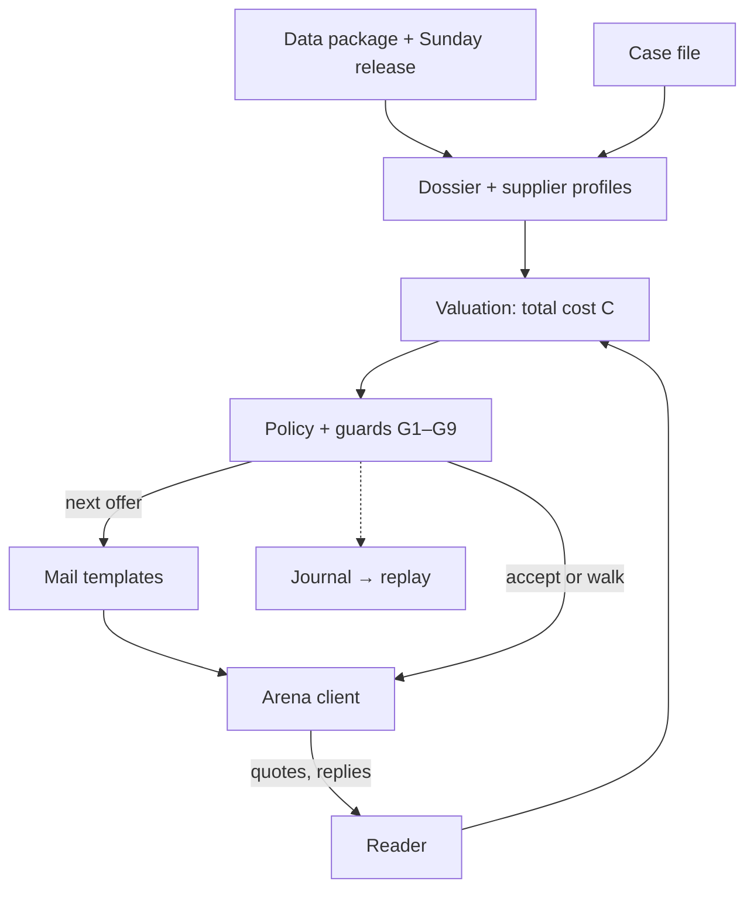

# Parley architecture

Parley is a buyer agent that negotiates with supplier agents of the Tacto Negotiation Arena by
e-mail and term sheets, with no human in the loop. This page describes the build that plays the
Live Final (v1.38). The same notes, with a diagram, are at https://parley.sorevo.de/architecture.

## The one idea

**Code owns every number.** Prices, terms, data IDs, figures, deadlines and every API call come from
deterministic Python. Templates write the e-mails around them. An optional model layer exists, but the
final runs without it (`--no-llm`): on 90 paired games of our persona bank it moved the score by
**+0.0001** (95 % CI −0.004 … +0.005), while a decision took 7.4 s instead of 0.2 s (p95). Our paired
tests found no measurable gain, so models are used only offline, to prepare supplier data that code
checks against the source.

**What is optimised** is the arena score: the share of the possible saving,
`(C_open − C_deal) / (C_open − C_best)`, clipped to 0…1, where C is the total cost over the contract.
Every must-have must be kept, and a deal must beat the case's alternative.

## Data flow per case

Each round: the arena client brings the supplier's reply, the reader classifies it, valuation prices
every standing and possible sheet, the policy picks the next offer (or accepts or walks), and the
templates turn it into an e-mail. Round 0 is the suppliers' quote e-mails with their PDFs. Outside the
live loop: the supplier profiles were prepared once, offline; the mail lint runs in our tests; the
replay is built after a session has ended. The runner plays all cases of a wave in parallel under a
supervisor with a fallback chain.

## Modules

| Step | Where | What it does |
| --- | --- | --- |
| Data | `ops/sunday_data.py`, `parley data` | pulls the data package and the Sunday 08:00 release; the release gets a checksum manifest that the final runner checks |
| Dossier | `agent/parley/dossier.py` | per supplier: facts it may cite (should-cost, notice periods, falling indices, scorecards, complaints, forecasts, its own last price jump, news), each with the data ID the arena checks; IDs are checked against `facts.json` before they go into a mail. Release items join the same way, e.g. inputs "bought forward / secured for 2027" count as hedged, a lost customer in the news as free capacity |
| Supplier profiles | `agent/cache/personas.json`, `profile_fields.json` | prepared offline from the data package only. The profiles give patience, levers and the cash and hedge signals the policy uses; a cash or hedge flag is kept only if its evidence quote is found in the data. The 17 profile fields per detailed supplier (approval threshold, levers, capacity, price freeze, cash need, hedged inputs, who signs) carry a source ID and a verbatim quote, verified when they were built; a second model family cross-checked all 46 suppliers, a third 10. Most field-based switches are off in the final because they did not pass our gate |
| Valuation | `agent/parley/valuation.py` | the arena's published cost formula, with our estimates for supplier inputs the arena does not show: price × volume, payment interest, freight by Incoterm, late lead time, expected defects minus chargebacks, tooling, uncovered need and fallback-supply risk, index clause path and risk, and on relationship goals the **supplier-health charge** (supplier full cost estimated as should-cost / 1.02; it matched the arena within 1 % on our own sessions). With that charge, C over price is U-shaped, so the cheapest price for us is searched, not assumed. It also prices what a package is worth to the supplier, with a **cost of money** per supplier from documented evidence (balance sheet, credit news, early-payment discounts) and the payment terms it picks; stock phrases such as "faster payment is welcome" do not count |
| Policy | `agent/parley/policy.py`, `rules.py` | opening anchor (deeper for leverage and RFQs, never below the estimated floor; on relationship goals a further 3 % of the opening price lower); steps that react to the supplier (less after a big step, almost nothing after an announced internal step, more when it holds); packages that cost us the same and differ in one lever (up to three sheets in round 1, two later, one when closing); two facts in round 1, then one new fact per round; the close |
| Reader | `agent/parley/analyst.py` | rules read each reply: status, claim verdicts, signal sentences (cash, capacity, freeze, approval) |
| Writer | `agent/parley/writer.py` | templates pick an opening for the situation (price letter, renewal, RFQ, capacity, quality), never repeat within a thread, name the concern the supplier raised; code inserts figures, facts with IDs and the sheets |
| Runner | `agent/parley/runner.py` | arena client, one worker per supplier thread, cap handling, journal, resume after a crash |
| Supervisor | `ops/final.py` | restarts, fallback chain, lock, state file |

### Guards G1–G9

Fixed rules, pinned by tests in `agent/tests/`:

| | Rule |
| --- | --- |
| G1 | no counter-offer after a supplier's final offer: Parley mirrors the supplier's own cheaper alternative sheet or ends the thread, and the close accepts the best standing offer or walks |
| G2 | RFQ: once the leading bid is clearly cheapest (more than 5 % ahead) and within 3 % of our ask, or the leader agrees, the case closes at once instead of waiting on the other bidders |
| G3 | acknowledge only a concern the supplier raised (cash, margin), never its cost-driver story |
| G4 | no index clause as a lever toward a supplier whose inputs are hedged, unless it asked for one; round-1 clause sheets that would raise our cost are dropped |
| G5 | where the arena charges supplier health and a full-cost estimate exists, packages start from the estimated health floor |
| G6 | in a thread, the raised cost of money needs a real cash statement or the supplier choosing our short-payment sheet |
| G7 | retries of a send reuse its move ID; after a timeout or 409 the runner re-reads the arena's state before it decides again |
| G8 | the first ask never goes deeper than the depth we tested |
| G9 | the dossier is built before the first move; if it fails it is retried once, then the case plays on a plain profile instead of crashing |

Acceptance checks on top: an offer is taken only if it keeps every must-have, costs less than the
opening and less than the alternative; a quote whose PDF could not be read cannot satisfy an open
must-have; and a deal with a low estimated score is not closed while moves, a fresh fact or an unused
lever are left.

### RFQs

Each bidder has its own thread. The first moves of all bidders are decided in a fixed supplier order
before any is sent, so which bidder gets which fact does not depend on timing. From round 1 the
cheapest rival price goes to every dearer bidder as a checked claim. Bidders far behind (more than 8 %)
are parked. A clear best bid within 3 % of our ask (measured on its value) is taken, and the case
closes at once (G2). When a final offer leads, Parley waits up to 30 s for bidders that have not
answered, then closes.

### Time

The arena allows 60 s per message and caps each wave at 8 minutes. The runner begins closing about
90 s before the cap, on the cheapest standing offer that keeps every must-have and beats the
alternative. Time-aware pacing counts, from measured round trips, how many rounds still fit before the
close; only when time binds does the policy take bigger steps, and a message whose reply would land
after the close is not sent. With normal reply times it rarely has to act.

## Parameters of the final build

The constants that shape a negotiation, as they stand in `agent/parley/policy.py` and `runner.py`.
They were set by hand, then tested on our own persona bank (paired, same cases and seeds) and, where
noted, on sandbox and practice cases. For the swept ones, no other value met our rule for a change
(at least +0.01 in two runs, no persona down by more than 0.02, no new zero), so they stayed.

| Parameter | Value | What it does | How we tested it |
| --- | --- | --- | --- |
| First-ask depth | leverage 16 %, routine 12 %, quality first 10 %, stabilise 8 %, secure supply 6 % below the opening; RFQ +8 points; at most 22 % (RFQ 26 %) | where round 1 opens | deeper anchors across the board lost on practice cases; only the relationship-goal rule below passed |
| Relationship depth rule | +3 points for stabilise and secure supply | the first ask on those goals was so shallow that suppliers often agreed at once | paired bank runs; off in the `safe` fallback build |
| Should-cost clamp | 0.94 | never ask below 94 % of our estimate of the supplier's cost | swept 0.92–0.98: 0.98 cost −0.016, 0.92 gained +0.004; kept |
| Reciprocity | 0.6 | our step = 0.6 × the supplier's step, as a share of the gap | swept 0.4–1.0: −0.004 … +0.007, never +0.01; kept |
| Step limits | 5–25 % of the gap; 15 % after the supplier closed more than 40 % of it; at least 15 % toward a supplier that keeps moving | bounds every concession | 25 % cap swept: flat (±0.002); the mover floor passed two paired runs (+0.003 each) |
| Price-increase step | at least 20 % of the gap once the supplier moves on its increase | keeps price-increase cases from stalling | gated with the price-increase rules on bank and sandbox |
| Facts in round 1 | 2, then one new fact per round | how much evidence the first mail carries | swept 1–3: 2 is best (1: −0.005, 3: −0.003) |
| Cost of money | 6.5 % corporate, 9.5 % family-owned or unknown, 14 % with documented cash need; 10 % in a thread after a real cash statement or a chosen short-payment sheet | how much a supplier values faster payment | swept 0.05–0.25; 0.10 adopted (bank +0.006, practice case P04 +0.058) |
| RFQ take | a bid more than 5 % ahead and within 3 % of our ask is taken; bidders more than 8 % behind are parked | closes RFQs before bidders walk | bank +0.0006 / +0.0037, no new zero; practice case P05 0.659 → 0.865 |
| Round-1 rival claim | on | the cheapest rival price goes to every dearer bidder from round 1 | alone it lost on practice (the bidder walked); paired with the take rule above it passed |
| Index clause | path capped at ±8 %; the 1.2 × clause-cost margin and a wider deadband as a lever exist behind a switch, off | the clause is priced in C exactly as the arena prices it | the switch gained +0.001 on the bank but lost on hold-out practice cases, so it stays off |
| Accept gap | 0.25 % | close when the gap to a standing offer is this small and the supplier stopped moving | set by hand |
| Low-score guard | 0.10 | below this estimated score, keep negotiating while moves, a fresh fact or a lever are left | set by hand |
| Send timeout | 180 s per attempt | how long a send waits for the supplier's reply | live replies p90 61–74 s, max about 100 s; 60 s made the client retry moves the arena was still answering |
| Close margin | 90 s before the cap | when the runner starts closing | fault rehearsal and a five-wave load test: no case open at the cap |

## Arena client and runner

- **Sends:** every POST carries an `X-Move-Id`; HTTP retries of the same send reuse it, so the arena
  sees one move. A send waits up to 180 s per attempt for the supplier's reply (live replies took up
  to about 100 s), bounded by the cap. Requests are paced below the arena's rate limit.
- **Timeout / 409:** after a timeout the runner re-reads the thread, after a 409 the session and the
  thread, and decides again from what the arena has. This is also how a restarted runner picks up its
  open sessions.
- **429 / 5xx:** a short 429 is waited out (`Retry-After`) and retried; a 429 for a missing session
  slot is retried until shortly before the cap; the close is retried with backoff until shortly
  before the cap.
- **Waves:** `parley run --set final` waits through the 403 before wave 1, plays every case of a
  wave in parallel and stops after wave 5.
- **Journal:** every decision goes to `agent/runs/journal/<session>.jsonl`: the dossier, each mail
  with the reason for its terms, the cost C of every sheet, the facts cited, how the reply was read,
  the close and the result.

**Supervisor and fallback chain** (`ops/final.py`): the runner restarts 3 s after an exit; three
exits within 120 s switch to the next build: **rc** (the release candidate) → **safe** (the same
checkout with the recent switches set back to their older values) → **F1R** → **F1** (older tagged
builds, each in its own clean checkout with a locked environment).

## Decision log and replays

A presentation layer next to the agent; it reads ended sessions and never takes part in a negotiation.

- `/replay` shows our best ended session per case with its score against Tacto's house agent, as a
  speech-bubble conversation: one bubble per mail, the term sheets beside it, the journal's reason
  under each Parley turn, a portrait per supplier contact and a voiced version.
- `/replay/journal` walks through one negotiation round by round: why the agent wrote what it wrote.
- Portraits are flat, faceless SVG busts drawn from data (role, company category, country; no image
  model). Voices: one per party from `audio/voices.json` (accent from the country, tone from role and
  company size), rendered with ElevenLabs text-to-dialogue. Mails are trimmed by fixed rules only.

## How we test (our own tests)

| Test | What it guards |
| --- | --- |
| Persona bank (`eval/`) | 9 modelled supplier behaviours × 20 generated held-out cases, free and local, scored with the supplier-health charge. A change goes in only if the bank is not lower, no persona drops by more than 0.02, there are no new zeros and the sandbox is not lower |
| LLM-voiced suppliers | the bank with Claude, Gemini, GPT and DeepSeek models writing the supplier side; Parley scores ≈ 0.69–0.71 whichever family plays |
| Strength guards (`eval/guards/`) | our best own practice negotiations must stay reachable: every buyer turn is decided again with the build under test, and a build that would offer a worse sheet is blocked; strong personas may not drop |
| Sandbox and live practice | the arena's free cases three times per variant; the ten hosted practice cases once per release candidate |
| Mail lint (`eval/audit_mails.py`) | every buyer mail of a bank run: banned phrases, repeated openings, missing contact name, statements the supplier's mail does not back, sentence limits |
| Overfitting guard | a test fails if the agent's code names a case, supplier ID or supplier name; three practice cases are hold-outs |

## Operations

- **Pre-flight** (`ops/preflight.py`): keys, kit, install, tests, arena key, clock, disk, power and
  network as a PASS / WARN / FAIL table, before anything plays.
- **Fault rehearsal** (`ops/rehearsal.py`): the final simulated locally with the real supervisor:
  runner killed mid-wave, a crash loop that must switch builds, 60–120 s supplier delays, 429 bursts,
  missing release. Last run: every case got a session, pickup 1.7–5.0 s after a kill.
- **Sunday data** (`ops/sunday_data.py`): fetches the release, writes its manifest, refreshes the
  supplier profiles and smoke-tests the dossiers.
- **Export:** the public repo is an allowlisted copy of one commit, scanned for secrets and private
  paths before it is committed.

## Limits

- The supplier's inputs (floor, full cost, cost of money) are estimates from the data package; when
  they are wrong, Parley asks too much or leaves money on the table. The guards bound the damage, not
  the estimate.
- Our persona bank is a model of supplier behaviour, not the arena. We use it to compare versions and
  find failure modes, and confirm changes on the sandbox and practice cases.
- Templates keep every mail correct and fast, but they are less varied than model prose; our blind
  e-mail test rated them about the same.
